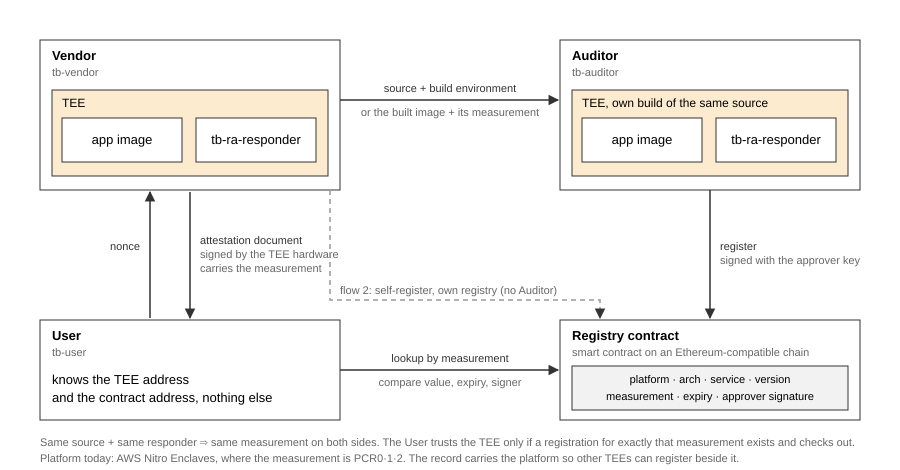

<p align="center">
  
</p>

<h1 align="center">Teestamp</h1>

<p align="center"><b>Remote attestation you can check against a public ledger.</b></p>

<p align="center">
  <sub>CREATED AND MAINTAINED BY</sub><br>
  <a href="https://github.com/spicslab-kr"><b>SPICS Lab</b></a>, <a href="https://www.khu.ac.kr">Kyung Hee University</a><br>
  <a href="https://github.com/spicslab-kr/tee-blockchain/issues">GitHub issues</a>
</p>

Software runs in a TEE (AWS Nitro Enclaves today). An independent Auditor rebuilds it, confirms the
enclave really runs those bytes, and registers the measurement on an Ethereum-compatible chain.
Anyone can then ask the enclave to attest itself and compare the answer with what is on-chain,
without a key from anyone.

<p align="center">
  
  
  
</p>

<p align="center">
  <a href="#install">Install</a> &nbsp;·&nbsp;
  <a href="#quick-start">Quick start</a> &nbsp;·&nbsp;
  <a href="#features">Features</a> &nbsp;·&nbsp;
  <a href="#project-resources">Project resources</a> &nbsp;·&nbsp;
  <a href="CONTRIBUTING.md">Contributing</a>
</p>

---

## Install

Download the Linux binaries for your architecture (`amd64` or `arm64`) from the
[latest release](../../releases/latest). They are built with the pinned toolchain and `-trimpath`,
and `SHA256SUMS` covers every file. Or build from source:

```
go build -trimpath -o tb-vendor       ./cmd/vendor
go build -trimpath -o tb-auditor      ./cmd/auditor
go build -trimpath -o tb-user         ./cmd/user
go build -trimpath -o tb-ra-responder ./cmd/ra-responder
```

The toolchain is pinned to exactly go1.26.1. `build` refuses any other version, because a
different patch version produces a different `tb-ra-responder` and therefore different
measurements. Details: [Build the binaries](cmd/README.md#build-the-binaries).

## Quick start

As a **User**, with an enclave address and a registry contract address. No keys, no ETH, no Nitro:

```
tb-user verify --tee <vendor-public-ip>:5000 --rpc <ethereum rpc url> --contract <0x…>
```

Exit 0 and a line like `✓ matches  nginx 1.31.6 (amd64) by 0x…, expires …` means a registration
matches. Exit 1 prints the reason. Measured from Korea against a Nitro enclave in eu-north-1 and
Ethereum mainnet: about 3 s and 21 MB peak.

As a **Vendor**, on a Nitro instance, with the directory that holds your Dockerfile:

```
tb-vendor build  --app-dir <dir> --out out      # reproducible enclave image + measurements
tb-vendor launch --eif out/<name>.eif           # run it, open the attestation port
tb-vendor send   --repo <git url> --config build-config.json
```

As an **Auditor**, on a Nitro instance, with the Vendor's repository:

```
tb-auditor receive --repo <git url> --into work/src
tb-auditor build   --app-dir work/src/<path> --out out
tb-auditor launch  --eif out/<name>.eif
tb-auditor audit   --config work/src/build-config.json --tee <my-instance>:5000 \
                   --measurements out/measurements.json --rpc <url> --contract <0x…> --key-file <key>
```

## Features

<p align="center">
  
</p>

### Three roles, four binaries

- **One binary per role.** `tb-vendor`, `tb-auditor` and `tb-user` each contain only their own
  role's commands. The User's binary has no `register` at all.
- **A shared in-enclave responder.** `tb-ra-responder` answers attestation requests inside the
  enclave. `build` layers it into the image.
- **Two flows.** Flow 1: the Auditor rebuilds and registers, and the User trusts only what the
  Auditor signed. Flow 2: a Vendor without an Auditor registers to its own registry, and the User
  can require that both registries agree.

### Vendor

- **Reproducible enclave image.** `build` and `pack` layer the responder onto your Docker image and
  normalize everything Docker makes nondeterministic.
- **Reproducibility scan.** Unpinned packages, `date`, random keys and the like are reported line by
  line, and `--verify` builds twice and fails unless both measurements are identical.
- **Build-environment declaration.** `build-config.json` records source, OS, CPU architecture and
  toolchain, so the Auditor can rebuild in the same environment.
- **Launch and self-check.** `launch` starts the enclave, bridges the port, and attests itself.
- **Self-registration (flow 2).** `self-register` attests, registers and checks in one command.

→ [Vendor guide](cmd/vendor/README.md)

### Auditor

- **Environment check.** `receive` clones the Vendor's source and refuses to continue on a different
  OS, CPU architecture or Go version, because a mismatch would look like a finding.
- **Same bytes or no registration.** `audit` registers only if the enclave's attested value equals
  the Auditor's own build.
- **One registry, one approver.** `registry-deploy` creates a contract that accepts only that
  approver's EIP-712 signature.
- **Hand-back.** `send` publishes the measurement record and image to the Vendor.

→ [Auditor guide](cmd/auditor/README.md)

### User

- **One command.** `verify` asks the enclave to attest, verifies the document against the platform
  root, finds who registered that measurement, and checks every registration.
- **No secrets.** No key, no ETH, no Nitro, no Docker.
- **Trust decision.** A registration passes only if the measurement matches, it has not expired
  (judged on the chain's clock), and its signer is the contract's approver or an address you name.
- **Several registries.** Repeat `--contract` to require the Vendor's and the Auditor's registry to
  agree.

→ [User guide](cmd/user/README.md)

### Platform and registry

- **AWS Nitro Enclaves today.** Request, document verification against the AWS Nitro root, and
  measurement extraction are implemented end to end. GCP and Azure have request-side scaffolding
  only. Confidential VMs that measure a guest OS (AMD SEV-SNP, Intel TDX) are not covered.
- **The measurement is the identity.** The enclave image hash (PCR0·1·2) is what gets registered
  and looked up, so no name, version or key has to be known in advance.
- **One architecture, one record.** x86_64 and arm64 builds measure differently, so each
  registration says which architecture it is for.
- **A deliberately simple contract.** `Registry.sol` never overwrites and never revokes. Expiry is
  the only way a record ends.

→ [Registry contract](contracts/README.md)

## Project resources

- [Project structure](STRUCTURE.md): every folder and module, and how the roles fit together
- [Contributing](CONTRIBUTING.md): build, test, layout, commit conventions
- [End-to-end scripts](e2e/README.md): our runs against real Nitro instances
- [Releases](../../releases)

## Testing

```
go test ./...
```

Unit tests run anywhere. `cmd/*_e2e_test.go` build the real binaries and drive them against a local
[anvil](https://getfoundry.sh) chain and a recorded Nitro attestation document. No Nitro hardware is
needed for any test.
