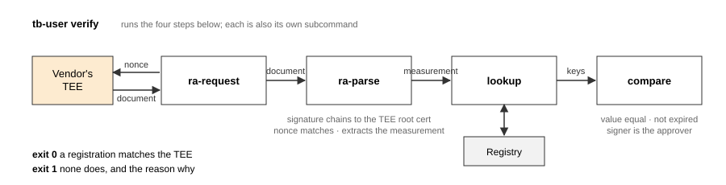

# tee-blockchain

**Remote attestation you can check against a public ledger.** Software runs in a TEE (AWS Nitro
Enclaves today); an independent Auditor rebuilds it, confirms the enclave really runs those bytes,
and registers the measurement on an Ethereum-compatible chain. Anyone can then ask the enclave to
attest itself and check the answer against what is on-chain — with no key from anyone.


[Install](#install) · [Quick start](#quick-start) · [How it works](#how-it-works) · [Operator guide](#operator-guide) · [Contributing](CONTRIBUTING.md)

## Three roles, four binaries

Each role gets its own binary, and a role's binary only contains that role's commands — the
User's binary has no `register` at all.

| binary | who runs it | where | one-command entry point |
|---|---|---|---|
| `tb-vendor` | **Vendor** — runs the service in an enclave | Nitro-enabled EC2 | `build` / `launch`, `self-register` (flow 2) |
| `tb-auditor` | **Auditor** — rebuilds the same source, vouches on-chain | Nitro-enabled EC2 | `audit` |
| `tb-user` | **User** — asks the enclave to attest, checks it against the chain | anywhere with network | `verify` |
| `tb-ra-responder` | the program that answers attestation requests *inside* the enclave | layered into the enclave image by `build` / `pack` | — |


TEE platform today: AWS Nitro Enclaves.

Flow 1 (default): the Vendor hands the Auditor the source (or the built image), the Auditor
rebuilds and registers, the User trusts only what the Auditor signed. Flow 2: a Vendor without an
Auditor registers to its own registry; an Auditor can audit it afterwards and the User can demand
both registries agree (`--contract` twice).

## Install

Download the four Linux binaries for your architecture from the
[latest release](../../releases/latest) (`amd64` and `arm64`, built with the pinned toolchain and
`-trimpath`, with `SHA256SUMS`). Or build from source:

```
go build -trimpath -o tb-vendor       ./cmd/vendor
go build -trimpath -o tb-auditor      ./cmd/auditor
go build -trimpath -o tb-user         ./cmd/user
go build -trimpath -o tb-ra-responder ./cmd/ra-responder
```

The toolchain is pinned to exactly go1.26.1 (`internal/setup/build/GO_TOOLCHAIN`); `build`
refuses any other version because a different patch version produces a different
`tb-ra-responder` and therefore different measurements. Details in [section 0](#0-build-the-binaries-and-put-them-where-they-run).

## Quick start

As a **User**, with an enclave address and a registry contract address — no keys, no ETH, no Nitro:

```
tb-user verify --tee <vendor-public-ip>:5000 --rpc <ethereum rpc url> --contract <0x…>
```

Exit 0 and a line like `✓ matches  nginx 1.31.6 (amd64) by 0x…, expires …` if a registration
matches; exit 1 with the reason otherwise. Measured end to end against a Nitro enclave in eu-north-1
and Ethereum mainnet from Korea: about 3 s and 21 MB peak, of which document verification is
about 12 ms and the rest is network round trips.

As a **Vendor**, on a Nitro instance, with the directory that holds your Dockerfile:

```
tb-vendor build  --app-dir <dir> --out out                # reproducible enclave image + measurements
tb-vendor launch --eif out/<name>.eif                     # run it, open the attestation port
tb-vendor send   --repo <git url> --config build-config.json   # push your build-config.json (source commit, build env) for the Auditor
```

As an **Auditor**, on a Nitro instance, with the Vendor's repository:

```
tb-auditor receive --repo <git url> --into work/src       # clone, read build-config.json, check the env matches
tb-auditor build   --app-dir work/src/<path> --out out    # reproducible EIF + measurements
tb-auditor launch  --eif out/<name>.eif                   # run it, bridge :5000
# attest own enclave, compare with the build, register, self-check:
tb-auditor audit --config work/src/build-config.json --tee <my-instance>:5000 --measurements out/measurements.json --rpc <url> --contract <0x…> --key-file <key>
```

The full per-role walkthrough is the [Operator guide](#operator-guide) below.

## How it works



- **Platform: AWS Nitro Enclaves today, by design not only.** Every record carries a `platform`
  field and the document format is a flag (`--format aws-nitro`), so other TEEs can register and be
  looked up beside Nitro. What is implemented end to end today is Nitro only: request, document
  verification against the AWS Nitro root, and the measurement extracted from it. GCP Confidential
  Space and Azure have request-side scaffolding and no verification; confidential VMs that measure a
  guest OS (AMD SEV-SNP, Intel TDX) need their own design and are not covered.
- **The measurement is the identity.** The hash of the enclave image (PCR0·1·2 on Nitro) is what
  gets registered and what the User looks up — by measurement alone, so no name, version or key has
  to be known in advance.
- **Same source ⇒ same bytes.** `build` layers the responder onto the Vendor's Docker image and
  normalizes everything Docker makes nondeterministic (file order, timestamps, install logs). What
  it cannot fix (unpinned packages, `date`, random keys) it reports line by line, and `--verify`
  builds twice and fails unless the measurements are identical. The Vendor writes its build
  environment to `build-config.json`; the Auditor refuses to build on a different OS, CPU
  architecture or Go version, because a mismatch would look like a finding.
- **One architecture, one record.** x86_64 and arm64 builds of the same source measure
  differently, so each registration says which architecture it is for.
- **The registry is dumb on purpose.** `Registry.sol` accepts a record only with the approver's
  EIP-712 signature, never overwrites, never revokes; expiry is the only way a record dies. One
  contract has exactly one approver, fixed at deployment — changing it means a new address, which
  cannot be hidden.
- **The User trusts the approver, not the registrant.** `compare` passes only if the record's
  measurement equals the enclave's, the record has not expired, and its signer is the contract's
  approver (or an address you name with `--trusted`). Expiry is judged against the time of the block
  that answered the lookup, not this machine's clock — the same clock the contract itself uses. Who vouched for the value is the signer; the
  Vendor's own word never enters the decision.

## Testing

```
go test ./...                       # unit tests, run anywhere
```

`cmd/*_e2e_test.go` build the real binaries and drive them end to end against a local
[anvil](https://getfoundry.sh) chain and a recorded Nitro attestation document; the chain-backed ones skip themselves
when `anvil` is not on `PATH`. No Nitro hardware is needed for any test. The scripts under `e2e/`
are our own runs against real instances (Sepolia by default, mainnet behind a confirmation flag);
the paper's measurements were taken on Ethereum mainnet.

---

# Operator guide

The chain-side work of each role collapses to one command — `audit` (Auditor), `verify` (User),
`self-register` (Vendor, flow 2); the steps it wraps are listed under each role so you can see
exactly what it does, or drive them by hand.

## 0. Build the binaries and put them where they run

```
go build -trimpath -o tb-vendor  ./cmd/vendor
go build -trimpath -o tb-auditor ./cmd/auditor
go build -trimpath -o tb-user    ./cmd/user
go build -trimpath -o tb-ra-responder ./cmd/ra-responder
```
The required Go toolchain is pinned to exactly the version in `internal/setup/build/GO_TOOLCHAIN`
(currently go1.26.1): a different patch version produces different `tb-ra-responder` bytes and so
different measurements, and `build` refuses to run under a toolchain other than the pinned one. Cross-compile for the Nitro instances (Linux) with `GOOS=linux GOARCH=amd64`.
`-trimpath` matters for `tb-ra-responder` specifically — it gets layered straight into the enclave
image, so building the identical source from a different folder path would otherwise leave a
different absolute path baked into the binary, and the measurement (PCR) with it.

- **Vendor's Nitro instance**: `tb-vendor` **and** `tb-ra-responder`, in the same directory.
- **Auditor's Nitro instance**: `tb-auditor` **and** `tb-ra-responder`, in the same directory.
- **User**: `tb-user`, anywhere with network access — no Nitro, no Docker, no keys.

`tb-ra-responder` is the program that answers attestation requests *inside* the enclave. `build`
layers it onto the software image, so it must be present next to the role binary. It is one
shared binary for every role, and both instances must get **the same file** — if Vendor and
Auditor embed different responders their measurements can never match. `build` and `pack` do not
take the file on trust: they read the build info Go leaves inside every binary and refuse a
responder built with a different Go than the pin, without `-trimpath`, or for another OS or
architecture than the instance they run on, and they print its sha256 in the build log so both
sides can compare. `build`, `launch` and
the responder only work on a Nitro-enabled EC2 instance (Linux); everything else runs anywhere.

## 1. Vendor

### 1.1 Build and launch the enclave: an image file or the source

Both cases must end with the same three things, because that is all the rest of the system uses:

| what | where it goes |
|---|---|
| the enclave image (`.eif`) | `launch`, and the hand-off |
| the measurements, nitro-cli's JSON (`{"Measurements":{"PCR0":…,"PCR1":…,"PCR2":…}}`) | `launch --measurements`, `register --measurements`, `compare --b` |
| the RA address `host:port` the enclave answers on | `--tee` for Auditor and User |

Building is optional for the Vendor — an EIF received from the Auditor works too (see 1.3); then
only the launch half applies.

#### Option 1: your image, handed over as a file

You build the software image however you like; tb packs it into an EIF; you give the Auditor the
EIF and its measurements. The Auditor never rebuilds — it measures the file it received.

Build the software image as you normally would:
```
docker build -t app:base <dir>
```

Pack it. Reads the image's original command, layers the responder and its entrypoint on top,
normalizes the layers, and writes `out/app.eif` and `out/measurements.json`:
```
tb-vendor pack --image app:base --out out
```

Run it — the enclave, the TCP 5000 → vsock bridge, a self-check attestation, and the
security-group port (or the one `aws ec2` line to run elsewhere):
```
tb-vendor launch --eif out/app.eif
```

Hand `out/app.eif` and `out/measurements.json` to the Auditor by any means (scp, mail). Its
`launch --eif <file> --measurements <file>` measures the EIF itself and launches it only if the
file measures to what the JSON claims.

Done by hand, this is the responder layer (three files and a six-line Dockerfile) followed by
`nitro-cli build-enclave`.

#### Option 2: the source, rebuilt by the Auditor

You give the Auditor the repository and commit; both of you run the same two commands on your
own Nitro instance and must get the same PCR0·1·2. That is the audit.

Build. Installs docker/nitro-cli, builds the image, layers the responder, normalizes the layers,
makes the EIF, and writes the measurements — `out/<name>.eif` and `out/measurements.json`:
```
tb-vendor build --app-dir <dir with Dockerfile> --out out
```
It first scans the Dockerfile for things known to break reproducibility (unpinned base image or
packages, `date`/`hostname`, random keys, compiling from source) and prints each with its line.
Add `--verify` to build a second time from scratch and fail unless the measurements come out
identical, listing the files that differed — worth it the first time a source is handed to an
Auditor.

Launch. Starts the enclave, bridges TCP 5000 → vsock, requests an attestation from itself to
prove it answers (`out/selfcheck.cbor`), and opens the security-group port — or, without IAM
permission on the instance, prints the one `aws ec2` line to run from your account:
```
tb-vendor launch --eif out/<name>.eif
```

### 1.2 `self-register` — attest my enclave, register, self-check

In flow 1 (the Auditor audits and registers) the Vendor does **not** register — after 1.1 it is
done. `self-register` is for flow 2, where the Vendor registers its own enclave:
```
tb-vendor self-register --config build-config.json --tee 127.0.0.1:5000 --rpc <url> --contract <0x…> --key-file <key>
```
`--config` is the same `build-config.json` that `send` pushes (1.3): the service, version and
build environment (`build_env`: OS, CPU architecture, Go toolchain, `-trimpath`) are taken from
it, so there is nothing to type twice. `--service`, `--version` and `--arch` still work and win
over the file, with a warning when they differ (`warning: --service nginx2 differs from
build-config.json (nginx)`); without `--config` they are required as before.
The confirmation names the CPU architecture and the Go toolchain the enclave was built with
(`registered nginx 1.31.6 (amd64, go1.26.1 -trimpath)`), since the registered value is only
reproducible in that environment. The architecture also goes on-chain, in the registration's
`arch` field, so `lookup` prints it back (`service nginx 1.31.6 (aws-nitro, amd64)`); it is
display only and not part of the lookup key.

What that does, one step at a time.

Send a fresh nonce to the enclave, get back the signed attestation document:
```
tb-vendor ra-request --tee 127.0.0.1:5000 --out doc.cbor
```

Verify the signature chain up to the platform root and the nonce, extract PCR0·1·2:
```
tb-vendor ra-parse --doc doc.cbor --out parsed.json
```

Sign those measurements with my key and register them on the contract. The `key` it prints
is the lookup coordinate:
```
tb-vendor register --rpc <url> --contract <0x…> --key-file <key> --measurements parsed.json --config build-config.json
```

Read the registration back by measurement alone:
```
tb-vendor lookup --rpc <url> --contract <0x…> --measurements parsed.json
```

Self-check: does what's on-chain match what the enclave attested, is it unexpired, is the
signer the contract's approver:
```
tb-vendor compare --a parsed.json --rpc <url> --contract <0x…> --key <key register printed>
```

Options. Add `--measurements out/measurements.json` to `self-register` and it compares the attestation
against your build value first and refuses to register on a mismatch (exit ≠ 0, the differing
PCRs are printed). Without `--config`, `--service`/`--version` are asked for on the first
registration; later ones reuse them. Any flag you leave out is asked for interactively — except `--rpc`, which defaults to
Ethereum **mainnet** and requires typing `y` to accept; any other URL (a testnet) is taken as-is.

### 1.3 Hand-off with the Auditor

Simplest: tell the Auditor the repository and the commit. That is all it needs to rebuild.

Or hand it over as a file. You write `build-config.json`; `send` pushes it to the root of the
repository:
```
tb-vendor send --repo <git url> --config build-config.json
```
```json
{
  "schema": "tb.build-config/1",
  "service": "nginx",
  "version": "1.31.6",
  "platform": "aws",
  "source":   { "repo": "https://github.com/<you>/<app>", "commit": "<git commit>", "path": "mainline/alpine-slim" },
  "tee_info": { "instance_id": "i-…", "region": "eu-north-1", "ami_id": "ami-…" },
  "build_env": { "os": "linux", "arch": "amd64", "go": "go1.26.1", "trimpath": true }
}
```
`build_env` is the environment the image was built in — OS, CPU architecture (`amd64` or
`arm64`), Go toolchain, and whether `-trimpath` was used. If you built with tb, leave it out and
`send` fills it in from the running binary; if you built outside tb, write it yourself. The Auditor
builds to that, not to whatever it has: PCR0·1·2 differ between x86_64 and arm64, and between Go
versions.

The Auditor must be able to read the repository — for a private one, give them read access
(collaborator or deploy key); tb does not manage permissions. `send`/`receive` exit codes: 3 git
not found, 4 repository unreachable (URL or permissions), 5 commit not found (`--ref`), 6 push
rejected (write access, or the remote is ahead — pull first). To do it by hand instead: commit
`build-config.json` at the repository root and push; the Auditor clones it and reads the file.

Later, when the Auditor has published its result, fetch it — `measurement-record.json` and the
EIF, with their hashes verified:
```
tb-vendor receive --repo <git url> --into from-auditor
```

## 2. Auditor

### 2.1 Get the source

Simplest: `git clone` the repository and `git checkout <commit>` the Vendor named.

Or, if the Vendor used `send`, this clones the repository, reads `build-config.json`, and checks
that the commit it names really is in the history:
```
tb-auditor receive --repo <git url> --into work/src
```
It also compares the Vendor's `build_env` with this instance and refuses to go on (exit ≠ 0) if
the OS, CPU architecture or Go version differ — a build here would not reproduce the Vendor's
measurements, and the mismatch would look like a finding. Move to a matching instance, or pass
`--ignore-env` if you know better. A Vendor that built without `-trimpath` gets a warning only.

### 2.2 Build and launch: an image file or the source

Identical to the Vendor's 1.1 with `tb-auditor` in place of `tb-vendor`. Reproducibility is the
whole point here: same source + same `tb-ra-responder` + normalized layers ⇒ the same PCR0·1·2 the
Vendor got. If they differ, that is the finding — do not register.

```
tb-auditor build --app-dir work/src/<path> --out out
```
```
tb-auditor launch --eif out/<name>.eif
```

### 2.3 Deploy the registry — once, first time only

One contract = one approver: only registrations signed by that address are accepted, forever.
The deployer key only pays gas; it can be anyone's. It prints the contract address — everyone
uses it:
```
tb-auditor registry-deploy --rpc <url> --key-file <deployer.key> --approver <my 0x…>
```
A registry deployed before registrations carried the CPU architecture (`arch`, see 2.4) has no
such field and does not accept the current `register`; deploy a new one to use it.

### 2.4 `audit` — attest my enclave, check it against my build, register, self-check

```
tb-auditor audit --config work/src/build-config.json --tee <my-instance>:5000 --measurements out/measurements.json --rpc <url> --contract <0x…> --key-file <key>
```
`--tee` is **my own** enclave, running **my own** build of the Vendor's source. That is the
audit: what goes on-chain is what I built from the source and ran myself, checked against the
build value, not what the Vendor told me.

`--config` is the Vendor's `build-config.json` — `receive` (2.1) left it in the clone root and
prints this command with the right path. The service, version and build environment
(`build_env`: OS, CPU architecture, Go toolchain, `-trimpath`) come from it; the Vendor already
said them, so they are not typed again. `--service`, `--version` and `--arch` still work and win
over the file, with a warning when they differ (`warning: --service nginx2 differs from
build-config.json (nginx)`). Without `--config`, `--service`/`--version` are required (or taken
from an existing registration of the same value) and `--arch` defaults to this machine's.

What that does, one step at a time.

Attestation document from my enclave:
```
tb-auditor ra-request --tee <my-instance>:5000 --out doc.cbor
```

Verify it, extract PCR0·1·2:
```
tb-auditor ra-parse --doc doc.cbor --out parsed.json
```

The audit gate: the enclave's attested value must equal my build value. FAIL means the
enclave is not running what I built; nothing gets registered:
```
tb-auditor compare --a parsed.json --b out/measurements.json
```

Register the **build value** with my key:
```
tb-auditor register --rpc <url> --contract <0x…> --key-file <key> --measurements out/measurements.json --config work/src/build-config.json
```

Read it back by measurement. The chain says which architecture the registration is for
(`service nginx 1.31.6 (aws-nitro, amd64)`) — `arch` is in the on-chain entry and signed with
it, but not in the key, so nobody has to know it to look the value up:
```
tb-auditor lookup --rpc <url> --contract <0x…> --measurements out/measurements.json
```

Self-check against the chain:
```
tb-auditor compare --a parsed.json --rpc <url> --contract <0x…> --key <key>
```

Pointing `--tee` at the **Vendor's** enclave instead is flow 2's "something looks off" check
(attest what the Vendor is actually running and compare it to my build) — fine as an extra
step, but flow 1 registers from my own enclave. Same optional flags and prompts as 1.2.

### 2.5 Hand the result to the Vendor

`measurement-record.json` carries the service/version, the PCRs, the build tool version and
the `build_env` the image was built in — OS, CPU architecture (`amd64` or `arm64`, GOARCH
spelling), Go toolchain and whether `-trimpath` was on — the same shape as build-config.json's
`build_env`. Everything but the PCRs and the build tool is already in the Vendor's
`build-config.json`, and the PCRs are in `out/measurements.json`, so `send` builds the record
from those two, fills in the EIF's sha256 and pushes record and image to the repository:
```
tb-auditor send --repo <git url> --config work/src/build-config.json --measurements out/measurements.json --image out/<name>.eif
```
The build tool is nitro-cli; its version is read from `nitro-cli --version` on this instance, or
given with `--build-tool-version`. The record it built is also left next to the measurements
(`out/measurement-record.json`).

Or write the record by hand and send that:
```
tb-auditor send --repo <git url> --record measurement-record.json --image out/<name>.eif
```
The same source measures differently on x86_64 and on arm64 (and under a different Go), so one
service/version has one record — and one registration — per CPU architecture, and each
registration says on-chain which one it is; `send` refuses a record that does not say which, and
warns when the record's Go is not the one this project pins.

## 3. User

```
tb-user verify --tee <vendor-public-ip>:5000 --rpc <url> --contract <0x…>
```
Ask the Vendor's enclave to attest → verify the document → find who registered that measurement
→ check each registration. Exit 0 if at least one registration matches (value, expiry, signer);
exit 1 with the reason if nobody registered it or none check out. No keys, no ETH. A matching
registration is shown with what the chain recorded for it, architecture included
(`✓ matches  nginx 1.31.6 (amd64) by 0x…, expires …`).

What that does, one step at a time.

Attestation document from the Vendor's enclave:
```
tb-user ra-request --tee <vendor-public-ip>:5000 --out doc.cbor --format aws-nitro
```

Verify it, extract PCR0·1·2:
```
tb-user ra-parse --doc doc.cbor --out parsed.json
```

Find the registration by measurement alone; no key from anyone is needed:
```
tb-user lookup --rpc <url> --contract <0x…> --measurements parsed.json
```

The trust decision, for each key `lookup` found:
```
tb-user compare --a parsed.json --rpc <url> --contract <0x…> --key <a key lookup found>
```


- `CONTRIBUTING.md` — build, test, layout and commit conventions
